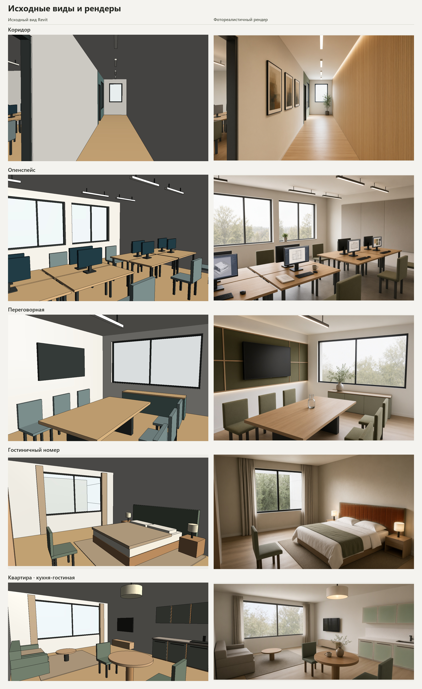

# Revit AI Render

Надстройка для Autodesk Revit 2024 и 2025. Она экспортирует выбранный 3D-вид, отправляет PNG и промпт на Mac по SSH/SFTP и показывает готовый рендер внутри Revit. Версия 0.3 также поддерживает запуск и получение рендеров в Codex через локальный MCP.

- **Новый рендер** открывает один экран для двух режимов. Обычно весь кадр обрабатывает Siliconed и Qwen-Image-2.1-Turbo. Флажок **Правка по маске** открывает инструменты выделения для MFLUX. Надстройка проверяет пиксели за пределами маски.
- **Результат** сразу показывает полный рендер. Можно открыть его крупно, сравнить с исходником и сохранить PNG.
- **История** хранит кадры, промпты и параметры. После потери связи можно проверить состояние той же задачи.
- **Подключение** открывает локальные настройки SSH, Siliconed и MFLUX. Доступность Mac можно проверить из Revit.

Вычисления выполняются на Mac. Надстройка использует установленные Siliconed и MFLUX, существующую аутентификацию OpenSSH и официальный API Revit для экспорта изображений.

[Скачать v0.3.1](https://github.com/proovcme/revit-ai-render/releases/tag/v0.3.1) · [Подключение MCP](MCP.md) · [Установка и сборка](УСТАНОВКА.md) · [Фактические проверки](ОТЧЁТ.md)

## Пример работы

Слева — исходные 3D-виды Revit, справа — готовые рендеры. Для гостиничного номера и кухни-гостиной после обработки кадра применена локальная правка по маске.

