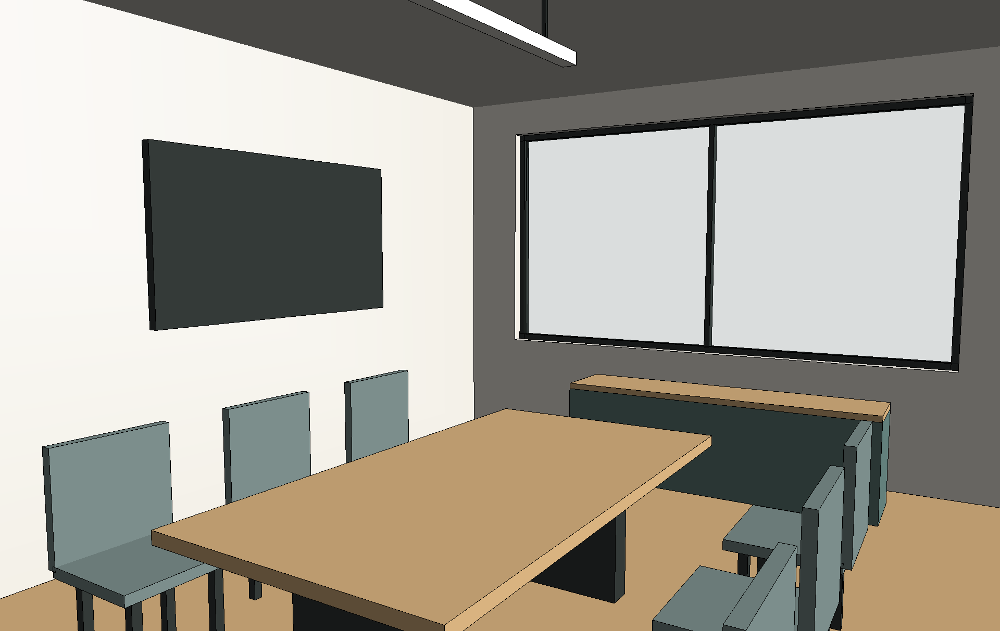
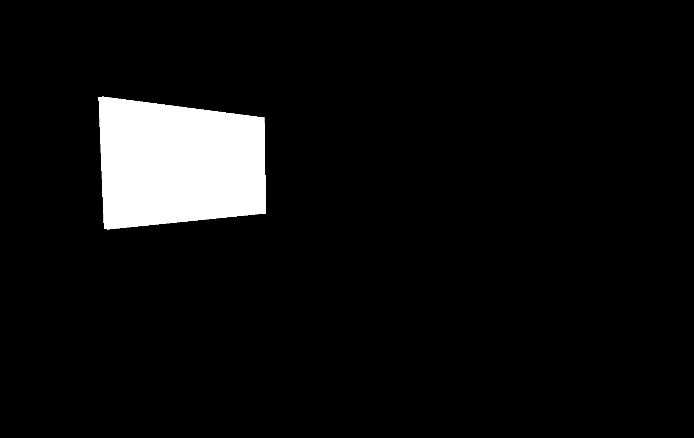
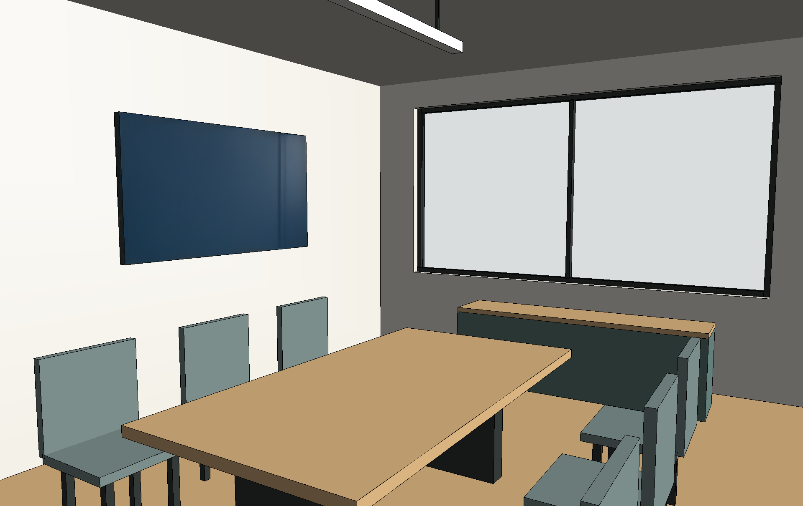

# Revit AI Render

Надстройка для Autodesk Revit 2024 и 2025. Она экспортирует выбранный 3D-вид, отправляет PNG и промпт на Mac по SSH/SFTP и показывает готовый рендер внутри Revit. Локальный MCP позволяет запускать рендеры и получать результаты в Codex.

- **Новый рендер** открывает один экран для двух режимов. Обычно весь кадр обрабатывает Siliconed и Qwen-Image-2.1-Turbo. Флажок **Правка по маске** открывает инструменты выделения для MFLUX. Маску видимых частей можно построить из выделения в Revit или передать ID элементов через MCP.
- **Результат** сразу показывает полный рендер. Можно открыть его крупно, сравнить с исходником и сохранить PNG.
- **История** хранит кадры, промпты и параметры. После потери связи можно проверить состояние той же задачи.
- **Подключение** открывает локальные настройки SSH, Siliconed и MFLUX. Доступность Mac можно проверить из Revit.

Вычисления выполняются на Mac. Надстройка использует установленные Siliconed и MFLUX, существующую аутентификацию OpenSSH и официальный API Revit для экспорта изображений.

[Скачать v0.4.0](https://github.com/proovcme/revit-ai-render/releases/tag/v0.4.0) · [Подключение MCP](MCP.md) · [Установка и сборка](УСТАНОВКА.md) · [Фактические проверки](ОТЧЁТ.md)

## Маска по элементу через MCP

В сквозном тесте 0.4.0 клиент MCP передал ID настенного экрана `214445` в Revit 2024.1.10. Надстройка построила маску видимой части элемента, MFLUX обработал участок на Mac, а `get_render` вернул итоговый PNG 1920 × 1213. Тот же кадр открылся во вкладке «Результат» в Revit.

| Исходный вид Revit | Маска экрана | Результат MCP |
| --- | --- | --- |
|  |  |  |

За пределами маски изменилось **0 пикселей**, контрольная сумма файла RVT совпала до и после теста. На экране появились синий фон и отражения. Линии чертежа из тестового промпта остались непрорисованными. [Отчёт о тесте](ОТЧЁТ.md#проверки-версии-040)

## Пример работы

Слева — исходные 3D-виды Revit, справа — готовые рендеры. Для гостиничного номера и кухни-гостиной после обработки кадра применена локальная правка по маске.

